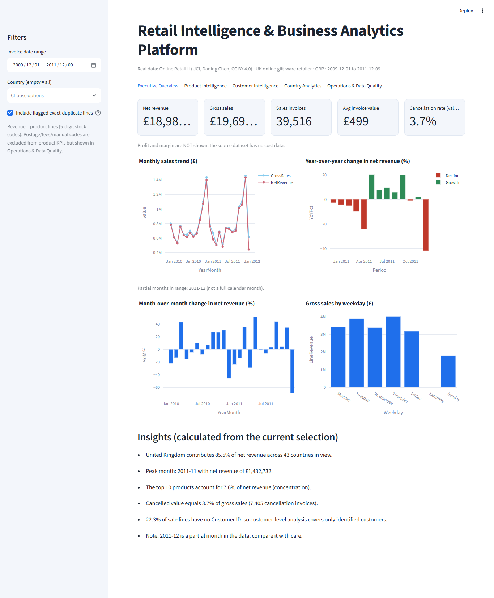
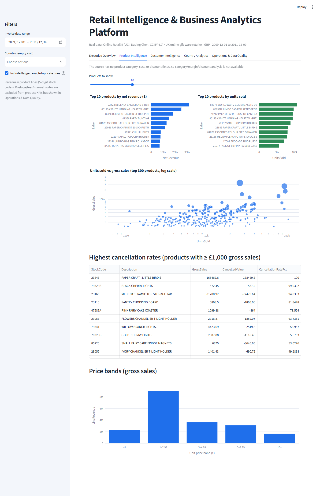
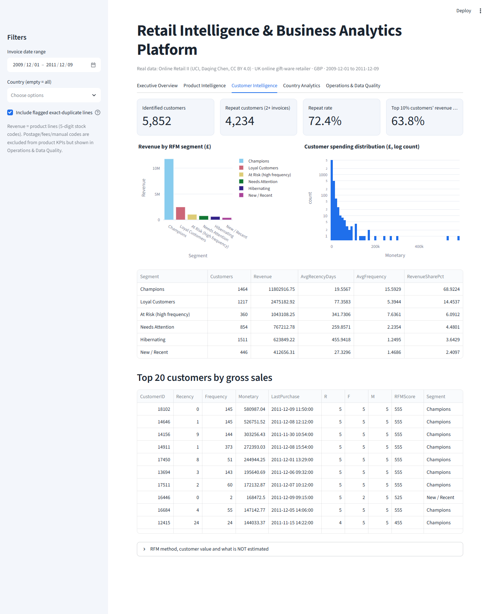
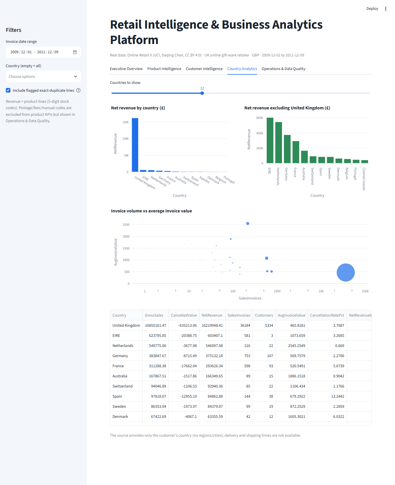
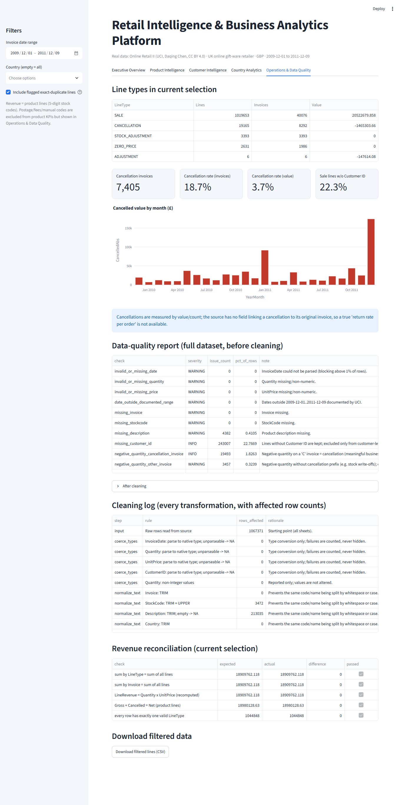

# Retail Intelligence & Business Analytics Platform

An end-to-end retail analytics project built with **SQL Server, Python, Pandas, Streamlit, and Plotly**.

The goal was to take a real retail transaction dataset, clean and organize the data, and turn it into useful business insights through SQL analysis and an interactive dashboard.

For this project, I used the publicly available **UCI Online Retail II dataset** rather than generating my own dataset. I wanted to work with real-world data, including missing values, cancellations, duplicate records, and other data-quality issues that analysts commonly face.

---


## Dashboard Preview

### Executive Overview



### Product Intelligence



### Customer Intelligence



### Country Analytics



### Operations & Data Quality



---

## About the Project

Retail businesses generate a large amount of transaction data, but raw records alone don't provide much business value.

I built this project to explore how retail transaction data can be transformed into meaningful information about:

- Sales and revenue trends
- Product performance
- Country-wise sales performance
- Customer purchasing behaviour
- Repeat customers and RFM segmentation
- Invoice cancellations
- Data quality and consistency

The project combines a Python-based data preparation pipeline, a SQL Server analytical database, and a Streamlit dashboard.

## Dataset

| Detail | Information |
|---|---|
| Dataset | Online Retail II |
| Source | UCI Machine Learning Repository |
| Creator | Daqing Chen |
| Publication | 2012 |
| License | Creative Commons Attribution 4.0 |
| DOI | [10.24432/C5CG6D](https://doi.org/10.24432/C5CG6D) |

The dataset contains approximately **1,067,371 transaction records** from a UK-based online giftware retailer, covering December 2009 to December 2011.

It includes invoice numbers, stock codes, product descriptions, quantities, invoice dates, unit prices, customer IDs, and countries.

**Dataset attribution:**

Chen, D. (2012). *Online Retail II* [Dataset]. UCI Machine Learning Repository. https://doi.org/10.24432/C5CG6D

The dataset is not included in this repository. It is downloaded from the official UCI source during project setup.

## Technologies Used

| Area | Technologies |
|---|---|
| Programming | Python |
| Data Processing | Pandas, NumPy |
| Database | Microsoft SQL Server |
| Data Analysis | T-SQL, CTEs, Window Functions |
| Dashboard | Streamlit |
| Visualization | Plotly |
| Testing | Python unittest-style tests, pytest |
| Development | PyCharm, VS Code, Git |

## What I Built

### 1. Data Cleaning and Preparation

I developed a Python pipeline to prepare the original transaction data for analysis.

Some of the operations include:

- Standardizing column names and data types.
- Cleaning stock codes using trimming and uppercase conversion.
- Handling missing product descriptions.
- Separating rejected or unparseable records.
- Identifying duplicate records across dataset sheets.
- Flagging duplicates within individual sheets.
- Classifying invoice lines using `LineType` and `ProductKind`.
- Calculating line revenue using quantity multiplied by unit price.
- Creating analytical fact and dimension datasets.

The original dataset is preserved. Cleaning operations are performed on the analytical data, and the pipeline generates reports to document the changes.

### 2. SQL Server Database

I designed a SQL Server database using a staging-to-analytical workflow.

The database includes:

- Staging invoice lines
- `FactInvoiceLines`
- `DimProducts`
- `DimCustomers`
- `DimCountries`
- `DimDate`

I also developed analytical views, stored procedures, business analysis queries, and data-quality checks.

The fact table uses one invoice line per record after cross-sheet overlap removal.

### 3. Business Analysis

The SQL analysis covers several business questions, including:

- How does revenue change over time?
- Which products generate the most revenue?
- Which countries contribute most to sales?
- How many customers make repeat purchases?
- What does customer RFM segmentation reveal?
- When are customers purchasing most frequently?
- How do cancellations affect transaction reporting?

The SQL scripts include CTEs, window functions, ranking, running totals, and time-based comparisons.

### 4. Interactive Dashboard

I used Streamlit and Plotly to build an interactive interface for exploring the prepared retail data.

The dashboard is designed to help users explore business performance through filters, KPIs, charts, and customer analysis.

## Project Architecture

The overall workflow looks like this:

```text
          UCI Online Retail II Dataset
                      |
                      v
             Python Data Pipeline
              (Download & Cleaning)
                      |
                      v
              Processed CSV Files
                      |
               +------+------+
               |             |
               v             v
          SQL Server      Streamlit
           Database       Dashboard
               |
               v
          Analytical Views
               |
               v
          Business Queries
          & Data Quality Checks
```

## Project Structure

```text
Retail_Intelligence_Portfolio/
│
├── .streamlit/
│   └── config.toml
│
├── data/
│   ├── raw/
│   └── processed/
│
├── docs/
│   ├── screenshots/
│   ├── analysis_report_template.md
│   ├── business_questions.md
│   ├── data_dictionary.csv
│   ├── dataset_selection.md
│   └── portfolio_walkthrough.md
│
├── scripts/
│   ├── download_data.py
│   └── prepare_data.py
│
├── sql/
│   ├── 01_create_database_and_tables.sql
│   ├── 02_load_transform_validate.sql
│   ├── 03_analytical_views.sql
│   ├── 04_business_analysis_queries.sql
│   ├── 05_data_quality_checks.sql
│   └── 06_stored_procedures.sql
│
├── src/
│   ├── __init__.py
│   ├── config.py
│   ├── data_loader.py
│   ├── data_cleaning.py
│   ├── kpi_calculations.py
│   ├── customer_segmentation.py
│   └── data_quality.py
│
├── tests/
│
├── app.py
├── setup_windows.bat
├── run_dashboard.bat
├── run_tests.bat
├── requirements.txt
├── pytest.ini
├── .gitignore
└── README.md
```

The actual repository may contain additional files. Generated datasets and local database files are not required to be committed.

## Installation and Setup (Windows)

I developed this project for Windows using Python and PyCharm.

### Requirements

- Windows 10 or later
- Python 3.11 or newer
- Git (for cloning the repository)
- SQL Server 2017 or newer (optional for the Streamlit dashboard, required for the SQL workflow)
- SQL Server Management Studio (SSMS)

### Step 1: Clone the Repository

```bash
git clone https://github.com/AnasDev23/retail-intelligence-analytics.git

cd retail-intelligence-analytics
```

### Step 2: Set Up the Environment

Run:

```bat
setup_windows.bat
```

The setup script creates a virtual environment, installs the required Python packages, downloads the dataset from UCI, and runs the data preparation pipeline.

The initial dataset download and processing may take several minutes.

### Step 3: Start the Dashboard

Run:

```bat
run_dashboard.bat
```

Alternatively:

```bash
.venv\Scripts\activate

streamlit run app.py
```

### Step 4: Run Tests

Run:

```bat
run_tests.bat
```

Or:

```bash
python -m pytest tests -v
```

## SQL Server Setup

The SQL Server workflow is included for users who want to explore the database and analytical queries.

First, run the Python data preparation script:

```bash
python scripts/prepare_data.py
```

Then open SSMS and execute the SQL scripts in the following order:

1. `01_create_database_and_tables.sql`
2. `02_load_transform_validate.sql`
3. `03_analytical_views.sql`
4. `04_business_analysis_queries.sql`
5. `05_data_quality_checks.sql`
6. `06_stored_procedures.sql` (optional)

For the bulk-loading step, make sure the SQL Server service account can access the CSV file location. Update the `@DataFolder` variable in the loading script accordingly.

Compare the SQL validation output with the generated `pipeline_summary.json` report.

## Testing & Verification

I tested the project components during development to make sure the data pipeline, SQL workflow, and dashboard work as expected.

**Completed:**

- Python modules compiled successfully.
- Data preparation and cleaning pipeline tested.
- SQL Server database and tables created successfully.
- SQL loading and transformation scripts executed.
- Analytical views and business queries executed.
- Stored procedures and data-quality checks tested.
- Streamlit dashboard developed and launched successfully.
- Dashboard charts, filters, and data analysis features tested.

**Testing approach:**

The project includes test cases for data cleaning, missing values, cancellations, duplicate records, and other data-quality scenarios.

Some results and analytical outputs depend on the original dataset and the configuration of the local SQL Server environment.

The fallback tests are not a substitute for a complete pytest run. The SQL scripts have been written for SQL Server 2017+, but still require execution and validation on a real instance.

The setup scripts and full test suite should be used to verify the project in a properly configured environment.

No business performance figures are claimed here because the full original dataset has not yet been processed and validated.

## Important Assumptions and Limitations

A few decisions were necessary to make the data suitable for analysis.

- Invoice numbers beginning with `C` are treated as cancellations.
- Invoices beginning with `A` are treated as adjustments.
- Negative quantities without a cancellation prefix are classified as stock adjustments.
- Product codes are classified using a defined stock-code pattern; other codes are treated as non-product items.
- Revenue KPIs use product lines only.

These are analytical assumptions, not additional facts supplied by the dataset creator. The resulting classifications should be reviewed after running the pipeline.

The dataset does not contain product costs or profit margins, so this project does not calculate profit, margin, or customer lifetime value.

**Other limitations include:**

- One retailer and a two-year transaction period.
- Revenue is recorded in nominal GBP.
- Cancellation records cannot reliably be linked to their original invoices.
- Product classification uses a heuristic rather than an official product category.
- Python and SQL RFM calculations may differ slightly in tie handling.

## What I Learned

Working on this project helped me explore several areas of data analytics and business intelligence:

- Building a repeatable ETL pipeline with Python.
- Working with imperfect real-world transaction data.
- Designing staging tables and a dimensional database structure.
- Writing analytical SQL queries using CTEs and window functions.
- Exploring customer purchasing behaviour through RFM analysis.
- Building interactive dashboards with Streamlit and Plotly.
- Validating data and documenting assumptions rather than presenting unsupported business results.

## Future Improvements

Some things I would like to add or improve:

- Complete validation using the original dataset.
- More detailed cohort analysis.
- Market basket analysis.
- A Power BI report connected to SQL Server analytical views.
- Additional dashboard comparisons and visualizations.
- Further improvements to data-quality reporting.

## About Me

I'm **Anas Islam**, a BS Information Technology graduate interested in Business Intelligence, Data Analytics, AI/ML, and software development.

I built this project as part of my practical learning and portfolio development to strengthen my understanding of working with real-world data and building complete analytical solutions.

**Connect with me:**

- **GitHub:** [AnasDev23](https://github.com/AnasDev23)
- **LinkedIn:** [Anas Islam](https://www.linkedin.com/in/anas-islam-it/)
- **Email:** [anasislam.it@gmail.com](mailto:anasislam.it@gmail.com)

---

*This is an independent portfolio project built using publicly available data. It is not affiliated with or endorsed by the dataset creator or UCI Machine Learning Repository.*